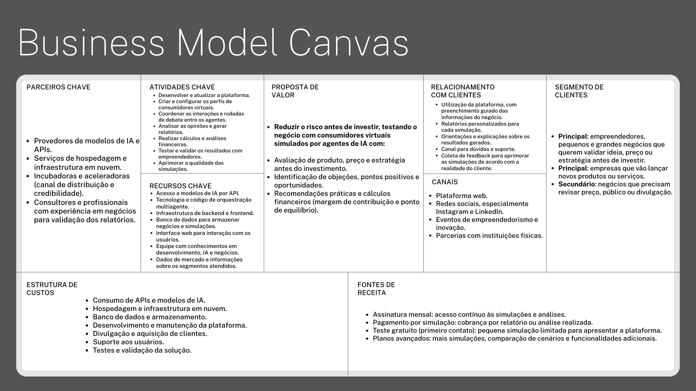

# MarketMind

**Simulador de mercado com múltiplos agentes de IA**: projeto da equipe para o **AKCIT Camp 2026**.

> Teste produtos, preços e estratégias antes de investir. O MarketMind pesquisa o mercado da sua região, coloca **6 especialistas** e **5 consumidores sintéticos** para avaliar a sua oferta (cada um sozinho, sem influência dos outros), filtra as opiniões exageradas e entrega um relatório com objeções, oportunidades, experimentos e uma análise financeira simples.

🚧 **Status:** em desenvolvimento. O andamento, as decisões técnicas e o histórico de cada commit estão em **[DESENVOLVIMENTO.md](DESENVOLVIMENTO.md)**. O guia da API para o frontend está em **[docs/api.md](docs/api.md)**.

---

## Sumário

1. [O problema](#o-problema)
2. [Como funciona](#como-funciona)
3. [Os agentes de IA](#os-agentes-de-ia)
4. [Relatório financeiro](#relatório-financeiro-sem-ia)
5. [O que o usuário recebe](#o-que-o-usuário-recebe)
6. [Avisos importantes](#avisos-importantes)
7. [Tecnologias](#tecnologias)
8. [API](#api)
9. [Como rodar](#como-rodar)
10. [Variáveis de ambiente](#variáveis-de-ambiente)
11. [Estrutura do repositório](#estrutura-do-repositório)
12. [Limitações conhecidas](#limitações-conhecidas)
13. [Modelo de negócio](#modelo-de-negócio)

---

## O problema

Quem vai abrir ou expandir um pequeno negócio precisa decidir **o que vender, quanto cobrar, para quem e como divulgar**, quase sempre com pouca informação e sem pesquisa de mercado acessível. Muitos negócios passam meses investindo antes de ter lucro.

O MarketMind **não promete prever** se um negócio vai dar certo. Ele oferece uma forma rápida e estruturada de **explorar hipóteses**, levantar objeções, comparar com o mercado da região e identificar o que merece ser validado com clientes reais.

---

## Como funciona

### 1. Entrada do usuário

| Campo | Obrigatório | Descrição |
|---|---|---|
| Nome e descrição do produto | Sim | O que será vendido e o diferencial |
| Segmento e modelo de venda | Sim | Ex.: alimentação, venda de serviço |
| Localização | Sim | Bairro e cidade (ex.: "Boa Viagem, Recife - PE"): define onde o pesquisador procura |
| Preço de venda | Sim | Valor unitário, em reais |
| Público pretendido | Sim | Quem se quer atingir |
| Divulgação | Sim | Canais planejados |
| Entrega | Não | "O produto pode ser entregue?" Modelo (próprio, app de delivery, motoboy/app de entregas, Correios), taxa, prazo, área e o que torna a entrega confiável |
| Custos | Não | Custo fixo mensal, custo médio de produção por unidade e taxa da plataforma (%) |
| Lucro esperado (%) | Não | Quanto do preço deve virar lucro |
| Investimento inicial | Não | Quanto vai investir para abrir (calcula em quanto tempo se paga) |
| Concorrentes (até 3) | Não | Nome, preço e observação (cadastro manual) |
| Quem avalia | Sim | Quais especialistas e consumidores participam (mínimo 2 no total; todos marcados por padrão) |
| Modo demonstração | — | Respostas de exemplo, sem chamar IA nem gastar cota |

### 2. Fluxo

```
Usuário preenche o formulário
        │
        ▼
Agente pesquisador ──► preços de negócios parecidos na internet (cidade do usuário, bairro primeiro)
        │                + lojas do mesmo ramo no mapa (bairro → cidade)
        ▼
Agente de contexto (código) ──► dados do negócio + concorrentes + referência de mercado + FATOS CALCULADOS
        │                        (ex.: "o preço está 60% abaixo da média da região")
        ▼
Avaliações individuais, ao mesmo tempo e sem conversa entre os agentes:
        │   • 6 especialistas (Gemini) → um parecer técnico cada
        │   • 5 consumidores (Groq)    → a reação de cada perfil de cliente
        ▼
Filtro (código) ──► retira pedidos de prova/foto/certificado e "caro" que contradiz os fatos
        │
        ▼
Agente analista ──► compila, descarta o que mais for extrapolado e escreve o relatório final
        │
        ▼
Calculadora financeira (código) ──► lucro por venda, cenários por clientes/dia, retorno do investimento
        │
        ▼
Interface ──► avaliações chegando ao vivo (SSE) + relatório final
```

**Por que multiagentes?** Não é um chatbot escrevendo várias opiniões de uma vez. Cada agente tem instruções, prioridades e área próprias, recebe só os dados do negócio e opina **sozinho**. Antes havia um debate em 2 rodadas, mas as personas reagindo umas às outras deixavam as opiniões mais duras e repetitivas, sem acrescentar informação; por isso ele foi retirado. Quem cruza as visões é o analista.

**Princípio da divisão de trabalho:** **números são calculados pelo código** (médias, desvios, margens, lucros, contagens); **a IA escreve texto** e recebe os números prontos, sem poder alterá-los.

---

## Os agentes de IA

| Agente | Usa IA? | Provedor / modelo (padrão) | Arquivo |
|---|---|---|---|
| Pesquisador de mercado | Sim (planeja e lê preços) | Groq `gpt-oss-20b` (plano) e `gpt-oss-120b` (extração) | `backend/app/agents/pesquisador.py` |
| Contexto e fatos calculados | Não | — | `backend/app/agents/contexto.py` |
| 6 especialistas | Sim | **Gemini** `gemini-3.5-flash-lite`, reserva no Groq | `backend/app/agents/especialistas.py` |
| 5 consumidores | Sim | **Groq** `gpt-oss-20b`, reserva no Gemini | `backend/app/agents/personas.py` |
| Orquestrador | Não | — | `backend/app/services/orquestrador.py` |
| Analista (relatório) | Sim | Groq `gpt-oss-120b`, reserva no Gemini | `backend/app/agents/analista.py` |

Os modelos são configuráveis no `.env`. Especialistas e consumidores usam provedores diferentes para **dividir o consumo de tokens** (cada plano grátis tem limite por minuto).

### 1. Agente pesquisador de mercado

Monta uma **referência de mercado** antes das avaliações. Roda sempre nas simulações reais; no modo demonstração usa uma pesquisa gravada.

**Etapas:**
1. **Planejar (IA):** identifica o tipo de estabelecimento, o produto comparável e a cidade, e escolhe uma categoria do mapa de uma **lista fechada** (a IA não inventa categorias).
2. **Buscar preços (Tavily):**
   - 3 buscas (geral, popular e premium), a primeira já com o bairro, até 8 páginas cada.
   - Se vierem **menos de 12 preços ou menos de 5 estabelecimentos**, faz até 2 rodadas extras com outros termos (só páginas novas).
3. **Filtrar pela cidade:** descarta páginas que não citam a cidade do usuário e lê primeiro as que citam o bairro.
4. **Recortar:** o código guarda só trechos curtos ao redor de valores em R$, o que gasta menos tokens.
5. **Extrair (IA)** e **validar (código):** um preço só é aceito se estiver escrito no trecho citado. O código também:
   - limita a 3 preços por estabelecimento;
   - descarta valores menores que 20% ou maiores que 5 vezes o preço do usuário (taxas, por exemplo).
6. **Calcular (código):**
   - 3 faixas (**popular, intermediária, premium**), definidas pelos terços de preço quando há 3 preços ou mais;
   - média, desvio-padrão, mínimo e máximo de cada faixa;
   - posição do preço do usuário: % acima ou abaixo da média e a quantos desvios-padrão.
7. **Contar lojas (OpenStreetMap, em paralelo):**
   - **perto do bairro** (raio de 2 km);
   - se não houver nenhuma, conta na **cidade inteira**;
   - se nem na cidade houver, não informa número.
   - Nível de concorrência: 0 = nenhuma mapeada · 1–3 = baixa · 4–10 = média · mais de 10 = alta.
8. **Observação:** quando nada parecido é encontrado, avisa *"pode ser um negócio único na região"*. Só faz isso se a busca funcionou: falha técnica não é ausência de concorrente.

Cada parte falha sem derrubar a simulação. Há **cache de 24 h** por negócio.

### 2. Agente de contexto e fatos calculados (sem IA)

Transforma o formulário num texto padronizado para todos os agentes, separando a **origem** de cada dado (informado pelo empreendedor, concorrentes cadastrados, referência automática).

Acrescenta os **fatos calculados**, que os agentes **não podem contradizer**:
- *"O preço (R$ 18,00) está 60% abaixo da média dos concorrentes informados (R$ 45,00)."*
- *"O preço está 59% abaixo da média de preços encontrada na região."*
- *"Cada venda deixa R$ 9,00 de margem (50% do preço)."*

Esses fatos resolvem um problema real das primeiras versões: agentes chamando de caro um preço muito abaixo do mercado.

### 3. Os 6 especialistas

Avaliam o negócio **como consultores de pequenos negócios**, cada um só na sua área.

| Especialista | Avalia |
|---|---|
| Precificação e Finanças | Se o preço é coerente com o produto, os concorrentes, o mercado e os custos; recomenda um preço |
| Marketing e Divulgação | Se os canais alcançam o público e se a proposta é fácil de comunicar |
| Operações e Entrega | Se a produção, o atendimento e a entrega são viáveis e confiáveis |
| Mercado Local e Concorrência | Como a oferta se compara aos concorrentes e à referência de mercado |
| Experiência do Cliente | O que atrai o público, o que pode afastar e o que faz voltar |
| Consultor de Pequenos Negócios | Viabilidade geral, riscos dos primeiros meses e primeiros passos |

**Parecer de cada um:**
- resumo;
- **nota de 0 a 10** e **veredito** (favorável · favorável com ajustes · desfavorável);
- pontos fortes, riscos e recomendações;
- avaliação do preço (baixo / adequado / alto) e preço sugerido.

**Regras principais:**
- O que o dono descreveu é verdade; os especialistas não criticam a falta de fotos, provas ou certificados.
- Nunca contradizem os fatos calculados.
- Não inventam números nem fazem afirmações técnicas sem base.
- A nota segue uma régua calibrada, sem dureza por padrão.

Se um parecer falhar no Gemini e no Groq, ele fica de fora e a avaliação continua.

### 4. Os 5 consumidores sintéticos

Mostram como diferentes perfis de cliente reagiriam. As personas são **genéricas**: traduzem as próprias prioridades para qualquer ramo de negócio.

| Consumidor | Prioriza |
|---|---|
| Econômico | Preço baixo e custo-benefício |
| Exigente | Qualidade do que recebe, capricho e bom atendimento |
| Ocupado | Praticidade, rapidez e previsibilidade |
| Crítico | Diferencial frente aos concorrentes que já conhece |
| Fiel à Região | Proximidade, confiança e atendimento pessoal |

**Resposta de cada um:**
- fala em primeira pessoa;
- interesse de 0 a 10 e decisão (compraria: sim / talvez / não);
- pontos positivos e objeções;
- **preço máximo** que pagaria;
- uma mudança realista que resolveria a sua principal objeção.

**Regras principais:**
- Pensar como **cliente comum**, não como especialista.
- O que foi descrito é verdade.
- Não cobrar provas, fotos, certificados ou "qualidade comprovada".
- Avaliar a entrega pelo que foi informado.
- Seguir a régua de interesse, com coerência ("sim" exige interesse 7 ou mais; "não" exige 4 ou menos).

### 5. Orquestrador (sem IA)

- Roda consumidores e especialistas **ao mesmo tempo**, cada grupo no seu provedor e com o seu limite de chamadas simultâneas.
- Publica cada avaliação no feed ao vivo assim que fica pronta.
- **Não há conversa entre os agentes:** ninguém vê a opinião de ninguém.

### 6. Agente analista (relatório final)

Trabalha em três etapas:
1. **Filtro do código (antes da IA):** retira das opiniões dos consumidores os trechos que pedem prova, foto, certificado ou avaliações, e os que chamam o preço de caro quando ele está **15% ou mais abaixo** da referência.
2. **Compilação crítica (IA):** junta consumidores e especialistas, dá mais peso ao que aparece nos dois grupos e **descarta** o que mais for extrapolado. Exemplos: contradizer os fatos, afirmação técnica sem base, criticar algo que foi informado, inventar números.
3. **Relatório:** resumo, elogios e objeções (com quem disse), fatores de decisão, pontos de atenção por área (Preço, Produto, Conveniência, Divulgação), recomendações por prioridade, experimentos e a lista **"O que o analista descartou"**.

**Indicadores calculados pelo código:**
- Interesse médio dos consumidores e decisões (sim / talvez / não).
- **Preço ideal:**
  - se a maioria dos consumidores pagaria o preço cobrado (máximo de cada um ≥ 97% do preço, ou "compraria: sim"), o preço é mostrado como **preço ideal**;
  - se a maioria aceitaria até 10% a mais, aparece **"há espaço para subir"**;
  - senão, mostra o valor do meio entre os máximos que pagariam.
- Nota média dos especialistas e contagem de vereditos.

**Experimentos:** testes em que o cliente paga (combo de lançamento, plano semanal, cupom para a 2ª compra, pré-venda, teste A/B de anúncio), sempre dizendo o que medir. Amostra grátis e degustação **não são o padrão**: no máximo uma sugestão, e só se fizer sentido no ramo.

---

## Relatório financeiro (sem IA)

Aparece quando o usuário informa os custos. Todas as contas ficam em `backend/app/services/financeiro.py`.

```
receita líquida por venda  = preço × (1 − taxa da plataforma)
lucro por venda (margem)   = receita líquida − custo médio de produção
lucro do mês (N clientes)  = N × 26 dias × lucro por venda − custo fixo mensal
tempo para se pagar        = investimento ÷ lucro do mês
preço p/ o lucro esperado  = custo ÷ (1 − taxa − lucro esperado)
```

**O que mostra:**
- **Veredito do preço:** dá prejuízo · abaixo do lucro esperado (com o preço que o atingiria) · dentro do esperado.
- Lucro por venda, custo fixo e investimento.
- **Simulador "considerando N clientes por dia":** barra interativa com lucro diário, lucro mensal, faturamento e em quanto tempo o investimento se paga.
- **Gráfico** de lucro (verde) ou prejuízo (vermelho) do mês por clientes/dia; clicar numa coluna leva o simulador para aquela quantidade.
- **Tabela de cenários:** quantidades que dão prejuízo e quantidades que dão lucro.
- **"E com outro preço?":** o preço que os consumidores pagariam, o preço para o lucro esperado, a média e a faixa premium do mercado, cada um com lucro por venda e quantos agentes pagariam.
- **Alertas:** app de delivery com taxa 0%, custo da entrega própria, custo fixo zero, investimento que não se paga em 2 anos.
- **Aviso em destaque:** não considera **impostos** nem **pagamento de funcionários** (salários, encargos e pró-labore); perdas, sazonalidade e meses iniciais mais fracos também ficam de fora.

Premissas: 1 cliente = 1 venda; 26 dias de funcionamento por mês.

---

## O que o usuário recebe

- **Durante a análise:** a referência de mercado e cada parecer e opinião chegando ao vivo.
- **Panorama:**
  - nota dos especialistas;
  - interesse dos consumidores;
  - preço ideal ou preço que pagariam;
  - tempo e tokens gastos.
- **Decisão de compra** dos consumidores e o que agradou ou gerou objeção.
- **Pareceres** completos dos especialistas.
- **Mercado na região:**
  - régua das 3 faixas de preço com o preço do usuário marcado;
  - lojas do ramo e nível de concorrência;
  - fontes com link.
- **Seu negócio se paga?** (o relatório financeiro).
- **Relatório do analista**, com experimentos e as opiniões descartadas.
- **Histórico** completo das opiniões dos consumidores.

---

## Avisos importantes

- As opiniões são **sintéticas**, geradas por IA: não representam uma amostra estatística de clientes reais.
- O sistema separa **dados informados pelo usuário**, **concorrentes cadastrados**, **referência automática de mercado** e **opiniões geradas por IA**.
- A referência de mercado é **aproximada**:
  - preços encontrados na internet (com links das fontes);
  - lojas mapeadas no OpenStreetMap, que não tem todas as lojas pequenas, por isso o número é sempre um mínimo.
- Não apresentamos "chance de sucesso" nem previsão de vendas: apenas **hipóteses a validar**.
- O cálculo financeiro é simplificado e depende dos valores informados.

---

## Tecnologias

| Parte | Tecnologia |
|---|---|
| Frontend | React 19 + Vite + TypeScript |
| Backend | Python 3.12 + FastAPI + Uvicorn; feed ao vivo por Server-Sent Events (SSE) |
| IA (texto) | **Groq** (`openai/gpt-oss-20b` e `openai/gpt-oss-120b`) e **Google Gemini** (`gemini-3.5-flash-lite`), com cadeia de reserva e **modo demo** sem chave |
| Busca na internet | **Tavily** (reserva opcional: Ollama web search) |
| Mapa | **OpenStreetMap**: Nominatim e Overpass, sem chave |
| Validação de dados | Pydantic |
| Testes | pytest (backend) |
| Armazenamento | Em memória (últimas 50 simulações; somem se o servidor reiniciar) |
| Deploy | Vercel (frontend) + Render (backend) |

**Cadeias de reserva:** se um provedor falhar ou estourar o limite, o próximo assume.

| Quem | Cadeia |
|---|---|
| Consumidores e pesquisador | Groq → Gemini → respostas gravadas |
| Especialistas | Gemini → Groq |
| Analista | Groq → Gemini, sem respostas gravadas: um relatório de outro negócio seria enganoso |

Detalhes e justificativas em [DESENVOLVIMENTO.md](DESENVOLVIMENTO.md).

---

## API

| Método | Rota | Para quê |
|---|---|---|
| `GET` | `/health` | Saúde da API |
| `GET` | `/personas` | Os 5 consumidores |
| `GET` | `/especialistas` | Os 6 especialistas |
| `POST` | `/simulacoes` | Inicia uma avaliação. Query `demo=true` (sem IA) e `agentes=<id>` repetido (quem participa; mínimo 2) |
| `GET` | `/simulacoes/{id}/stream` | Feed ao vivo (SSE) |
| `GET` | `/simulacoes/{id}` | Estado completo (ex.: ao recarregar a página) |

**Eventos do feed, em ordem:**
1. `etapa` (pesquisa)
2. `pesquisa`
3. `mensagem` (consumidor) e `parecer` (especialista), misturados, na ordem em que ficam prontos
4. `etapa` (análise)
5. `fim` (resultado completo, com relatório e financeiro)

Se algo der errado, chega `erro`. Formato completo dos dados em **[docs/api.md](docs/api.md)**; documentação interativa em `http://localhost:8000/docs`.

---

## Como rodar

**Pré-requisitos:** Python 3.12 e Node.js 20+.

**Backend (terminal 1):**

```powershell
cd backend
py -3.12 -m venv .venv
.venv\Scripts\Activate.ps1
pip install -r requirements.txt
copy ..\.env.example ..\.env     # preencha as chaves, ou deixe LLM_PROVIDER=mock
uvicorn app.main:app --reload
```

**Frontend (terminal 2):**

```powershell
cd frontend
npm install
npm run dev                      # abre em http://localhost:5173
```

Sem nenhuma chave, use o **modo demonstração** no formulário: o fluxo completo funciona com respostas gravadas.

**Testes e scripts úteis (na pasta `backend`, com a venv ativa):**

```powershell
python -m pytest                                    # testes (sem chave nem internet)
python -m scripts.simular --negocio marmita         # avaliação completa no terminal
python -m scripts.simular --provider mock           # o mesmo, com respostas gravadas
python -m scripts.pesquisar --negocio barbearia     # só o agente pesquisador
python -m scripts.testar_busca                      # confere Tavily e OpenStreetMap
python -m scripts.testar_llm                        # confere as chaves de IA
```

Negócios de exemplo para os scripts: `cafeteria`, `barbearia`, `roupas` e `marmita`, todos em Recife.

---

## Variáveis de ambiente

As chaves ficam **só** no `.env` local, que não vai para o Git, e nas variáveis do Render. **Nunca** em variáveis `VITE_` (elas vão para o navegador).

| Variável | Para quê |
|---|---|
| `LLM_PROVIDER`, `LLM_MODEL_PERSONAS`, `LLM_MODEL_ANALISTA` | Provedor e modelos principais (ex.: `groq`, `openai/gpt-oss-20b`, `openai/gpt-oss-120b`) |
| `LLM_FALLBACK_PROVIDER`, `LLM_FALLBACK_MODEL_PERSONAS`, `LLM_FALLBACK_MODEL_ANALISTA` | Provedor de reserva (ex.: `gemini`) |
| `LLM_ESPECIALISTAS_PROVIDER`, `LLM_MODEL_ESPECIALISTAS` | Provedor dos especialistas (padrão `gemini`; modelo vazio = `LLM_FALLBACK_MODEL_PERSONAS`) |
| `LLM_MOCK_NO_FIM`, `LLM_CONCORRENCIA`, `LLM_REASONING_EFFORT` | Respostas gravadas no fim da cadeia, chamadas simultâneas, esforço de raciocínio |
| `GROQ_API_KEY`, `GEMINI_API_KEY` | Chaves das IAs |
| `PESQUISA_MERCADO`, `BUSCA_PROVIDER`, `BUSCA_RESERVA`, `TAVILY_API_KEY`, `OLLAMA_API_KEY` | Agente pesquisador |
| `MAPA_RAIO_METROS` | Raio da contagem de lojas perto do bairro (padrão 2000) |
| `FRONTEND_URL` | Endereço do site (liberado no CORS) |
| `VITE_API_URL` | (só no frontend/Vercel) endereço da API |

Referência completa em [`.env.example`](.env.example).

---

## Estrutura do repositório

```
MarketMind/
├── README.md               # este arquivo
├── DESENVOLVIMENTO.md      # plano vivo, decisões e changelog
├── .env.example            # variáveis de ambiente de referência
├── bmc_marketmind.png      # quadro de modelo de negócio
├── docs/
│   ├── api.md              # guia da API para o frontend
│   ├── proposta.md         # proposta original
│   └── exemplos/           # resultado e pesquisa reais, em JSON
├── backend/
│   ├── app/
│   │   ├── api/            # rotas HTTP e feed SSE
│   │   ├── agents/         # pesquisador, contexto, especialistas, personas (consumidores), analista
│   │   ├── llm/            # provedores (Groq, Gemini, Ollama, mock) e cadeia de reserva
│   │   ├── services/       # orquestrador, simulações, calculadora financeira, mapa, busca na internet
│   │   └── models/         # schemas (formulário, opiniões, pareceres, pesquisa, relatório)
│   ├── demo_data/          # respostas gravadas do modo demo
│   ├── scripts/            # simular, pesquisar, testar_busca, testar_llm, avaliar_personas
│   └── tests/
└── frontend/
    ├── public/             # ícones e logos (SVG)
    └── src/
        ├── pages/          # Landing, formulário, análise ao vivo, resultado
        ├── components/     # cards de agentes e pareceres, mercado, financeiro, relatório
        └── services/       # cliente da API e do feed SSE
```

---

## Limitações conhecidas

- **Armazenamento em memória:** as simulações somem se o servidor reiniciar. O plano grátis do Render também "dorme" após 15 minutos parado, então a primeira chamada pode levar uns 50 s.
- **Cobertura do mapa:** o OpenStreetMap não tem todas as lojas pequenas do Brasil, e os servidores públicos do Overpass ficam sobrecarregados com frequência (o Nominatim cobre).
- **Preços na internet:** pequenos negócios nem sempre publicam preços; nesse caso a referência vem com poucos dados ou sem preços.
- **Limites dos planos grátis:**
  - uma avaliação completa gasta cerca de 25 mil tokens, divididos entre Groq e Gemini;
  - o Tavily oferece 1.000 buscas por mês, e cada avaliação usa de 3 a 9.
- **Qualidade das opiniões:** depende do modelo; as regras e o filtro reduzem, mas não eliminam, opiniões exageradas.

---

## Modelo de negócio



---

## Equipe

Projeto desenvolvido para o **AKCIT Camp 2026**. Frentes: Backend · Frontend · IA/Agentes · Produto/Validação.
